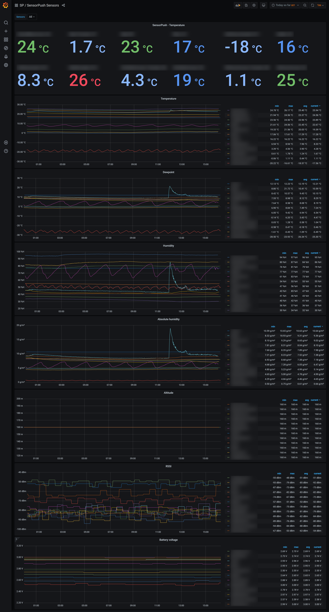

# SensorPush
[SensorPush](http://www.sensorpush.com/) recently introduced a [API](http://www.sensorpush.com/api/docs) to query the temperature and humidity samples recorded by their smart sensors via G1 WIFI GATEWAY - As long as the API is in beta stage, you have to contact support to get access!

This Python 3 tool can query the API and save the temperature and humidity time series to a time series database so it can easily be plotted with Grafana.

If you don't have an G1 WIFI Gateway and still want to plot your temperature, you can use another little tool I wrote to feed the CSV file which you can export via the Android App to InfluxDB.



## sensorpushd.py - Unified Daemon (Recommended)

`sensorpushd.py` is the unified replacement for the individual scripts. It supports **InfluxDB 2**, **InfluxDB 3**, and **VictoriaMetrics** in a single tool — including writing to **multiple backends simultaneously**. It can run either as a one-shot command (for cron) or as a continuous daemon (managed by systemd).

Changes and upgrade notes are listed in [CHANGELOG.md](CHANGELOG.md). The offline test suite runs with `python3 -m unittest discover -s tests`.

### Installation

```bash
# Required for all backends:
pip install requests

# Only install what you need for your chosen backend:
pip install influxdb-client      # for InfluxDB 2
pip install influxdb3-python     # for InfluxDB 3
# VictoriaMetrics needs no extra packages
```

### Quick Start

```bash
# First run creates a config template at ~/.sensorpushd.conf
./sensorpushd.py

# Edit the config file with your SensorPush credentials and backend settings
nano ~/.sensorpushd.conf

# One-shot: fetch last day of data (backward compatible with cron)
./sensorpushd.py -b 1d --backend victoriametrics

# Write to multiple backends simultaneously
./sensorpushd.py -b 1d --backend victoriametrics influxdb3

# Daemon mode: continuous polling every 5 minutes
./sensorpushd.py --daemon --interval 300

# Dry run to preview data without writing
./sensorpushd.py -b 1h -x --backend victoriametrics

# List your sensors, including the sensor_id each one is stored under
./sensorpushd.py -l
```

### Migrating from the old scripts

Your existing config files work directly:

```bash
# Use existing InfluxDB 2 config
./sensorpushd.py -c ~/.sensorpush.conf -b 1d

# Use existing VictoriaMetrics config
./sensorpushd.py -c ~/.sensorpush_vm.conf -b 1d
```

Coming from `sensorpush_vm.py` (or `sensorpush.py`): those scripts stored the full
SensorPush id in `sensor_id`, `sensorpushd.py` stores the shortened form described in
[Stored sensor ids](#stored-sensor-ids). Each sensor therefore continues in a new series.
Panels that select or group by `sensor_name` are unaffected; queries that filter on
`sensor_id` need both forms to cover the whole history.

### Configuration

The new unified config file (`~/.sensorpushd.conf`) supports all backends. Only configure the sections for the backend(s) you use. To write to multiple backends simultaneously, set `TYPE` to a comma-separated list. All backends are written with the `MEASUREMENT_NAME` of the first backend in `TYPE` (the daemon warns at startup if the sections disagree):

```ini
[SENSORPUSHAPI]
LOGIN = your_email@example.com
PASSWD = your_password

[BACKEND]
TYPE = victoriametrics
# For multiple backends: TYPE = victoriametrics, influxdb3

[INFLUXDB2]
MEASUREMENT_NAME = SensorPush
URL = http://localhost:8086
TOKEN = your_token
ORG = your_org
BUCKET = sensorpush
VERIFY_SSL = False
# Optional, see "Storing the full sensor id" below. Default: False
SENSOR_UID = False

[INFLUXDB3]
MEASUREMENT_NAME = SensorPush
URL = http://localhost:8181
DATABASE = sensorpush
TOKEN = your_token
VERIFY_SSL = False
SENSOR_UID = False

[VICTORIAMETRICS]
MEASUREMENT_NAME = SensorPush
URL = http://localhost:8428
VERIFY_SSL = False
SENSOR_UID = False

[DAEMON]
INTERVAL = 300
# How far every poll reaches back; at least 1h (see "Daemon features")
POLL_BACKLOG = 1h

[MISC]
MY_ALTITUDE = 0.0
FORCE_IPv4 = False
```

### Stored sensor ids

SensorPush sensor ids look like `123456.7890123456789012`: the device id, a dot and about
16 more digits. The `sensor_id` tag stores `str(float(id))`, Python's shortest form of the
nearest floating-point number, which keeps 15-17 significant digits:

| SensorPush id (API and app) | stored `sensor_id` |
|---|---|
| `123456.7890123456789012` | `123456.78901234567` |
| `12345678.9012345678901` | `12345678.901234567` |

The part before the dot is always kept in full, and the mapping is fixed, so any id can be
turned into its stored value:

```bash
./sensorpushd.py -l                                          # every sensor, with its stored sensor_id
python3 -c 'print(float("123456.7890123456789012"))'         # 123456.78901234567
```

`sensor_id` does not change when you rename a sensor, so it is the key for one particular
device. `sensor_name` follows renames, and the same name can later be given to a
replacement sensor, so it is the key for a place.

This format is kept on purpose. Every existing series, every query or alert that filters on
`sensor_id`, and the daemon's own gap detection depend on it; storing a different value
would start new series and make gap detection blind to existing data (see
[issue #9](https://github.com/bolausson/SensorPush/issues/9)). To store the full id as
well, see [Storing the full sensor id](#storing-the-full-sensor-id-sensor_uid).

**Which script stored which form.** `sensorpush.py` and `sensorpush_vm.py` stored the
full id, `sensorpush2.py` and `sensorpushd.py` store the shortened one. If you switched
between them, a sensor's history is split across both values. To query all of it, match
both:

```sql
-- InfluxQL
SELECT mean("temperature") FROM "SensorPush"
  WHERE ("sensor_id" = '123456.78901234567' OR "sensor_id" = '123456.7890123456789012') AND $timeFilter
  GROUP BY time($__interval)
```
```flux
// Flux (use == ... or ==, not contains(), which is not pushed down to storage)
|> filter(fn: (r) => r.sensor_id == "123456.78901234567" or r.sensor_id == "123456.7890123456789012")
```
```sql
-- SQL (InfluxDB 3)
SELECT ... FROM "SensorPush" WHERE sensor_id IN ('123456.78901234567', '123456.7890123456789012')
```
```promql
# PromQL / MetricsQL - label regexes are anchored; escape the dots
avg by (sensor_name) (SensorPush_temperature{sensor_id=~"123456\\.78901234567|123456\\.7890123456789012"})
```

For a quick look, the device id alone also matches both forms, e.g. InfluxQL
`"sensor_id" =~ /^123456\./`. Avoid it in saved queries: it also matches any earlier id
the same device had if it was ever removed and registered again.

### Storing the full sensor id (SENSOR_UID)

Set `SENSOR_UID = True` in a backend's section (`[INFLUXDB2]`, `[INFLUXDB3]`,
`[VICTORIAMETRICS]`, or `[INFLUXDBCONF]` / `[VICTORIAMETRICSCONF]` in the legacy config
files) and every point written to that backend from then on also carries the full id as
the tag `sensor_uid`. It is off by default, and `sensor_id` keeps its value either way.

What enabling it changes:

- **New series.** Like renaming a sensor, every sensor continues in a new series from the
  switch on; points stored before it have no `sensor_uid`. Queries that filter or group
  by `sensor_id` or `sensor_name`, and the shipped dashboards, keep showing one line.
  Queries that keep every tag apart - InfluxQL `GROUP BY *`, Flux without `group()`,
  PromQL/MetricsQL without `sum by`/`avg by` - show the old and the new series side by side.
- **A one-time overlap.** After the restart that enables it, the daemon re-reads the
  last `POLL_BACKLOG` (one hour), or more if it was stopped for longer than that. Those points are then stored with and without
  `sensor_uid`: `mean()` is unaffected, `count()` and `sum()` double for that stretch.
  The same happens whenever time from before the switch is fetched again, e.g. a one-shot
  run with `-s`/`-p`, or a back-fill for a second backend that had fallen behind.
- **Nothing else.** Gap detection and back-fills still key on `sensor_id` and find old and
  new series alike.
- **Backend support.** Early InfluxDB 3 Core builds (2024-12 to 2025-03) rejected
  writes that add a new tag to an existing table, and InfluxDB 3 Enterprise databases
  (or InfluxDB Cloud buckets) with an explicit schema need the tag declared first. If a
  backend rejects the writes, its log shows write errors; set `SENSOR_UID = False` again.

Turning it off again splits the series once more, the same way. `migrate_influx2vm.py`
copies `sensor_uid` as a label.

### Running as a systemd service

```bash
# Copy and edit the service file
sudo cp sensorpushd.service /etc/systemd/system/
sudo nano /etc/systemd/system/sensorpushd.service  # adjust paths

# Enable and start
sudo systemctl daemon-reload
sudo systemctl enable --now sensorpushd

# Check status and logs
sudo systemctl status sensorpushd
sudo journalctl -u sensorpushd -f
```

### Daemon features

- **Multi-backend**: Write to multiple databases simultaneously; each backend is independent — one failure does not block the others
- **Complete polls**: Every poll reaches back at least an hour (`POLL_BACKLOG`, default `1h`). The SensorPush API hands out each sensor's samples in chunks of about 15 minutes and selects a chunk by its *start* time, so a query from T returns only chunks that started at or after T. A shorter window silently misses most samples; shorter settings are raised to 1h with a warning. If you ran an earlier version with a 10-minute backlog, see [CHANGELOG.md](CHANGELOG.md) for how to back-fill what it missed
- **Gap-filling**: If the API or database was unavailable, the daemon automatically detects the gap on the next successful cycle and back-fills the missing data. It finds the gap by asking each backend for its newest stored point, so the token needs read access as well as write access. If a backend cannot be asked (a timeout, missing permission, or it is failing writes at that moment), the daemon resumes from the end of the last collection known to have completed (kept in `state.json`) instead of assuming an empty database. That mark is kept for the collector as a whole: a backend that rejected writes while another one kept working catches up once it accepts writes and answers lookups again. VictoriaMetrics needs v1.52 or later (`tlast_over_time()`)
- **Graceful shutdown**: Responds to SIGTERM/SIGINT for clean shutdown
- **Error recovery**: Retries with exponential backoff on API or backend failures; never exits on transient errors
- **Token refresh**: Proactively re-authenticates before the OAuth token expires
- **Configurable logging**: Use `--log-level` and `--log-file` for production logging

### CLI reference

```
./sensorpushd.py --help
```

All arguments from the old scripts are preserved (`-s`, `-p`, `-b`, `-t`, `-q`, `-d`, `-l`, `-g`, `-i`, `-n`, `-x`, `-v`), plus new ones:

| Argument | Description |
|----------|-------------|
| `--backend` | One or more of: `influxdb2`, `influxdb3`, `victoriametrics` |
| `--daemon` | Run as a continuous daemon |
| `--interval` | Polling interval in seconds (default: 300) |
| `-c`/`--config` | Path to config file |
| `--log-level` | `DEBUG`, `INFO`, `WARNING`, or `ERROR` |
| `--log-file` | Log to file instead of stderr |

## Legacy Scripts (Deprecated)

The individual scripts are still available but deprecated in favor of `sensorpushd.py`. They are kept as they are; changing what they store would split their users' series. Do not run them alongside the daemon against the same database: they store `sensor_id` in a different form.

| Script | Database | Config File | Stores `sensor_id` as |
|--------|----------|-------------|-----------------------|
| `sensorpush.py` | InfluxDB 1.x | `~/.sensorpush_legacy.conf` | full id |
| `sensorpush2.py` | InfluxDB 2.x | `~/.sensorpush.conf` | `str(float(id))`, like `sensorpushd.py` |
| `sensorpush_vm.py` | VictoriaMetrics | `~/.sensorpush_vm.conf` | full id |

`sensorpushd.py` has no InfluxDB 1.x backend, so `sensorpush.py` has no direct replacement.

## Grafana Dashboards

Example Grafana dashboards are included:
- `SensorPush-GrafanaDashboard.json` - Dashboard for InfluxDB
- `SensorPush-GrafanaDashboard-vm.json` - Dashboard for VictoriaMetrics (Prometheus data source)

Both select sensors by `sensor_name` and combine all series of a name into one line, so a
renamed sensor, a switch of the `sensor_id` form or enabling `SENSOR_UID` does not show up
as duplicate lines. (A dashboard you imported earlier is not updated by pulling a new
version of the file; re-import it to get the change.)

## Migration from InfluxDB to VictoriaMetrics

If you have existing SensorPush data in InfluxDB and want to migrate to VictoriaMetrics, use the `migrate_influx2vm.py` script:

```
# migrate_influx2vm.py --help
usage: migrate_influx2vm.py [-h] [-c CONFIG] [--ifdb-config IFDB_CONFIG] [--vm-config VM_CONFIG]
                            [--start START_TIME] [--end END_TIME] [--all]
                            [--batch-size BATCH_SIZE] [--chunk-days CHUNK_DAYS]
                            [--dry-run] [--verbose]

Migrate SensorPush data from InfluxDB 2.x to VictoriaMetrics

optional arguments:
  -h, --help            show this help message and exit
  -c CONFIG, --config CONFIG
                        Read both databases from a unified sensorpushd.py config
                        ([INFLUXDB2] and [VICTORIAMETRICS] sections)
  --ifdb-config IFDB_CONFIG
                        Path to InfluxDB config file (default: ~/.sensorpush.conf)
  --vm-config VM_CONFIG
                        Path to VictoriaMetrics config file (default: ~/.sensorpush_vm.conf)
  --start START_TIME    Start time (ISO format, or relative written as --start=-7d)
  --end END_TIME        End time (ISO format, default: now)
  --all                 Migrate all data from earliest available
  --batch-size BATCH_SIZE
                        Batch size for writes (default: 10000)
  --chunk-days CHUNK_DAYS
                        Days per chunk for large migrations (default: 7)
  --dry-run             Preview migration without writing data
  --verbose             Show detailed output
```

Example usage:
```bash
# Migrate all historical data
python migrate_influx2vm.py --all

# Migrate everything since a date
python migrate_influx2vm.py --start="2026-01-01T00:00:00Z"

# Migrate the last 30 days (relative times need the '=' form)
python migrate_influx2vm.py --start=-30d

# Preview migration without writing, reading the daemon's unified config
python migrate_influx2vm.py --config /etc/sensorpushd.conf --all --dry-run
```

The script copies `sensor_id` exactly as InfluxDB holds it, so history from different
scripts keeps its form (see [Stored sensor ids](#stored-sensor-ids)).

## CSV import
```
# sensorpush_csv-import.py --help
usage: sensorpush_csv-import.py [-h] [-f CSVFILE] [-s SENSORNAME]
                                [-i SENSORID] [--float-id] [-d] [-c CHUNKS]

Reads a CSV file exported from the SensorPush Android App and stores the temp
and humidity readings in InfluxDB

optional arguments:
  -h, --help            show this help message and exit
  -f CSVFILE, --csvfile CSVFILE
                        CSV file exported from the SensorPush Android App
  -s SENSORNAME, --sensorname SENSORNAME
                        Sensor name
  -i SENSORID, --sensorid SENSORID
                        Sensor id, in the form your collector stores it, so the
                        import lands in the same series
  --float-id            Store the id the way sensorpushd.py and sensorpush2.py do,
                        str(float(id)), e.g. 123456.7890123456789012 -> 123456.78901234567
  -d, --dryrun          Do not write anything to InfluxDB - just print what
                        would have been written
  -c CHUNKS, --chunks CHUNKS
                        Write data in chunks to InfluxDB to not overload e.g.
                        a RaspberryPi
```
